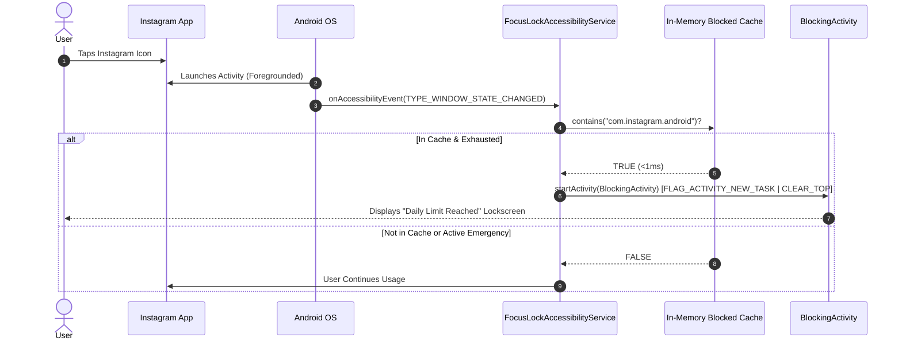

# Architectural Design & Data Flow — FocusLock

## 1. Architectural Philosophy: Clean Architecture & MVI/MVVM

FocusLock strictly follows **Clean Architecture** and **Unidirectional Data Flow (UDF)** principles:

```
[UI Layer (Jetpack Compose)] 
      ▲                      │
      │ State                │ Events / User Actions
      │                      ▼
[Presentation (ViewModels)]
      ▲                      │
      │ Flow<T>              │ Invocation
      │                      ▼
[Domain Layer (Use Cases & QuotaEngine)]
      ▲                      │
      │ Flow / Result        │ Queries / Updates
      │                      ▼
[Data Layer (Repositories & Room Database)]
      ▲                      │
      │ Entity Observation   │ DAO Operations
      │                      ▼
[Underlying OS / SQLite Database / Android Framework]
```

### Layer Boundaries & Separation of Concerns

1. **Presentation Layer (`com.focuslock.app.presentation.*`)**:
   - Built entirely with Jetpack Compose, Material 3, and Compose Navigation.
   - Screens are stateless where possible, taking UI state as immutable data classes and emitting event callbacks to ViewModels.
   - ViewModels expose state via Kotlin `StateFlow<T>` and handle lifecycle-aware coroutine operations.

2. **Domain Layer (`com.focuslock.app.domain.*`)**:
   - Contains business logic that is independent of Android UI components.
   - **`QuotaEngine`**: Central evaluation engine that checks daily quotas, emergency bypasses, active Pomodoro focus sessions, and Hardcore Mode restrictions.
   - **Use Cases**: Encapsulate discrete business operations (`EvaluateQuotaUseCase`, `HardcorePolicyUseCase`, `ScheduleResetUseCase`).

3. **Data Layer (`com.focuslock.app.data.*`)**:
   - Single source of truth is the local Room SQLite Database (`FocusLockDatabase`).
   - Repositories (`AppRepositoryImpl`, `UsageRepositoryImpl`) bridge raw Room entities with clean domain models, abstracting DB caching and async background synchronization.

4. **Service & System Layer (`com.focuslock.app.service.*`, `com.focuslock.app.core.*`)**:
   - Interfaces directly with Android OS services (`AccessibilityService`, `UsageStatsManager`, `WindowManager`).
   - Operates resilient background services and broadcast receivers (`TimeChangeReceiver`, `BootRecoveryReceiver`).

---

## 2. Instant Zero-Lag Blocking Architecture

Blocking restricted apps (like Instagram) on Android requires solving the OS-level race condition between the app launch and our overlay:



### Architectural Key Points:
1. **Low-Latency In-Memory Cache**: `FocusLockAccessibilityService` maintains a thread-safe `blockedPackagesCache` (ConcurrentHashMap/Set) continuously synchronized via Room DB observation. When an event fires, package checking takes `<1ms`, avoiding slow disk/Room DB reads on the UI looper thread.
2. **Direct Intent Launch**: `BlockingActivity` is launched immediately over the restricted app with `FLAG_ACTIVITY_NEW_TASK | FLAG_ACTIVITY_CLEAR_TOP | FLAG_ACTIVITY_NO_ANIMATION`.
3. **No Flashing Race Conditions**: We avoid calling `GLOBAL_ACTION_HOME` with synthetic delays before launching the overlay, ensuring an instant transition to the blocking screen.

---

## 3. Real Usage Tracking & Midnight Reset Architecture

1. **Foreground Usage Tracking (`RealUsageTracker`)**:
   - FocusLock queries `android.app.usage.UsageStatsManager.queryEvents()` over the period from local midnight (`00:00:00`) to current timestamp.
   - Matches `ACTIVITY_RESUMED` (start) and `ACTIVITY_PAUSED` / `ACTIVITY_STOPPED` (stop) timestamps to calculate exact discrete usage sessions.
   - Detects all Instagram package variants using `InstagramPackageHelper` (`com.instagram.android`, `com.instagram.lite`, etc.).

2. **Automated Midnight Reset Flow**:
   - `TimeChangeReceiver` listens for `ACTION_TIME_CHANGED`, `ACTION_TIMEZONE_CHANGED`, and `ACTION_DATE_CHANGED`.
   - `BootRecoveryReceiver` listens for `ACTION_BOOT_COMPLETED`.
   - When midnight transitions occur, `DailyUsageDao` records for the previous date freeze, new rows for the current date are seeded with `usedSeconds = 0`, and the `blockedPackagesCache` is flushed.
