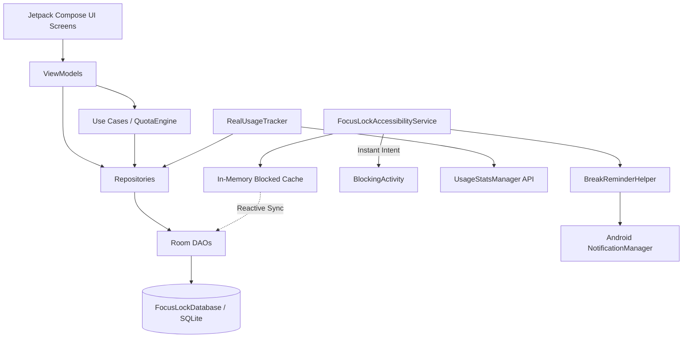

# Dependency Graph & Package Inventory — FocusLock

## 1. Internal Component Dependencies

### Module Cross-Reference Matrix

| Target Component | Depends On | Called By |
| :--- | :--- | :--- |
| `FocusLockAccessibilityService` | `blockedPackagesCache`, `FocusLockApp`, `BlockingActivity` | Android OS System Framework |
| `BlockingActivity` | `AppRepository`, `UsageRepository`, `QuotaEngine` | `FocusLockAccessibilityService` |
| `RealUsageTracker` | `UsageStatsManager`, `InstagramPackageHelper`, `TimeUtils` | `UsageRepositoryImpl`, `FocusLockAccessibilityService` |
| `QuotaEngine` | Pure Domain (no Android dependencies) | `BlockingActivity`, `AppDetailsViewModel`, `EvaluateQuotaUseCase` |
| `AppRepositoryImpl` | `ProtectedAppDao`, `PackageManager` | ViewModels, `QuotaEngine` |
| `UsageRepositoryImpl` | `DailyUsageDao`, `UsageSessionDao`, `RealUsageTracker` | ViewModels, `FocusLockApp` |
| `PinSecurityManager` | `EncryptedSharedPreferences`, Java Cryptography Architecture | `HardcorePolicyUseCase`, `SettingsViewModel` |

---

## 2. External Third-Party Libraries (Version Catalog)

From `gradle/libs.versions.toml`:

| Library / Artifact | Version | Purpose |
| :--- | :--- | :--- |
| `androidx.compose.bom` | `2024.09.00` | Jetpack Compose Bill of Materials |
| `androidx.compose.material3:material3` | (via BOM) | Material Design 3 components and styling |
| `androidx.navigation:navigation-compose` | `2.8.2` | Single-activity Compose navigation |
| `androidx.room:room-runtime` | `2.6.1` | Local SQLite database persistence |
| `androidx.room:room-ktx` | `2.6.1` | Kotlin Coroutine and Flow extensions for Room |
| `androidx.room:room-compiler` | `2.6.1` | KSP annotation processor for Room |
| `androidx.security:security-crypto` | `1.1.0-alpha06` | Hardware-backed MasterKey & EncryptedSharedPreferences |
| `org.jetbrains.kotlinx:kotlinx-coroutines-android` | `1.8.1` | Android main-looper coroutines |
| `com.google.android.material:material` | `1.12.0` | Fallback Material design components |
| `androidx.core:core-ktx` | `1.13.1` | Core Android Kotlin extensions |
| `androidx.lifecycle:lifecycle-viewmodel-compose` | `2.8.6` | Compose ViewModel integration |

---

## 3. Testing Libraries

| Library / Artifact | Version | Scope |
| :--- | :--- | :--- |
| `junit:junit` | `4.13.2` | `testImplementation` (JVM Unit Testing) |
| `org.jetbrains.kotlinx:kotlinx-coroutines-test` | `1.8.1` | `testImplementation` (TestCoroutineDispatcher) |
| `androidx.room:room-testing` | `2.6.1` | `testImplementation` (In-memory Room DB tests) |
